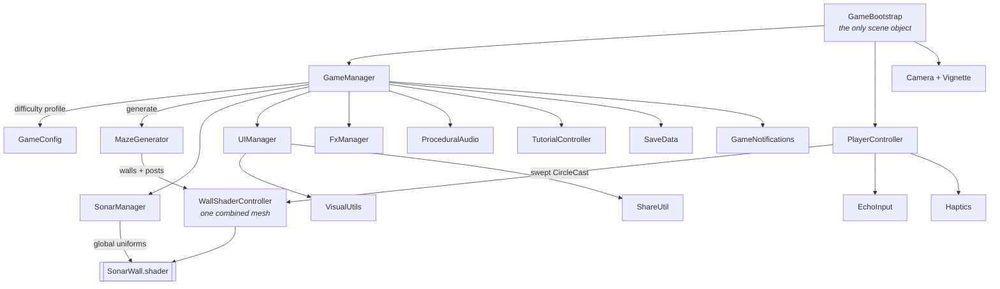

<div align="center">

# Sonarfall

### You can't see the maze. You can only listen for it.

A sonar puzzler for Android and iOS, where the walls are invisible until you ping them — and the light doesn't last.

by [**Vortex Forge Studios**](https://github.com/VortexForgeStudios)


<a href="docs/media/gameplay.mp4"></a>

[**Watch the 45-second gameplay video**](docs/media/gameplay.mp4)

[](https://unity.com/)
[](https://docs.unity3d.com/Manual/urp/urp-introduction.html)
[](#building)
[](#everything-you-see-is-code)
[](#project-layout)

</div>

---

## The idea

The screen is black. Somewhere in that black is a maze, and somewhere in the maze is an exit.

**Tap** and a sonar ring bursts out from your dot. Walls light up as the wavefront crosses them — then fade. You get a handful of reveals per level and a clock that starts at 34 seconds and tightens as you descend. What you actually carry to the exit is a *memory* of the layout, decaying in real time.

Every ping is a trade: spend one to see, or trust what you think you remember and move.

There is no points counter. Each clear earns up to three stars for how well you read the maze, and the level you have reached is waiting for you when you come back.

<div align="center">
  
  
  
  <br/>
  
  
  
</div>

---

## Everything you see is code

There are **no gameplay art or audio assets in this repository**. Not a single wall texture, particle sprite, UI icon or sound file. The only image files in the project are the two splash-screen logos and the Android notification icon.

Everything else is generated at runtime:

| What | How |
|---|---|
| Glows, rings, discs, vignette, gear, stars, UI frames | `Texture2D` written pixel by pixel in [`VisualUtils.cs`](Assets/Scripts/Utils/VisualUtils.cs), memoised so identical sprites share one instance. Additive sprites get one material per texture (`VisualUtils.SetAdditive`): sharing a single material across different textures draws only one of them on some platforms |
| Ping, wall ticks, music bed, heartbeat, exit beacon, hazard loops, win arpeggio | Synthesis into `AudioClip.Create` in [`ProceduralAudio.cs`](Assets/Scripts/Presentation/ProceduralAudio.cs) |
| Mazes | Recursive-backtracker generator producing a perfect maze plus its solution path ([`MazeGenerator.cs`](Assets/Scripts/Gameplay/MazeGenerator.cs)) |
| Dust, bursts, wall sparks | `ParticleSystem` built from code in [`FxManager.cs`](Assets/Scripts/Presentation/FxManager.cs) |
| The entire scene | One `GameBootstrap` component on one empty GameObject — no prefabs |

The scene file contains a single object. Press Play and the game assembles itself.

---

## How the sonar works

The reveal isn't a light or a mask — it's a shader reading a global array of recent pings.

`SonarManager` keeps the last four pings and publishes them every frame as `_SonarPings`, alongside the ring speed, fade and band width. [`SonarWall.shader`](Assets/Shaders/SonarWall.shader) then computes, per pixel, how long ago the wavefront crossed *that* point and lights it accordingly, with a white flash at the front edge.

```
ringRadius = (time - pingStart) * speed
crossedAt  = (ringRadius - distanceToPixel) / speed
brightness = 1 - crossedAt / fade          // and a hot band where crossedAt ~ 0
```

Because the walls are one combined mesh at identity transform, the shader's world-space maths just works, and the whole maze is **one draw call**. Audio "ticks" and haptics are driven separately by cheap distance checks against cached wall centres — no physics queries in `Update`.

> Both custom shaders are only ever resolved by `Shader.Find` at runtime, so they must stay in **Always Included Shaders** or they get stripped from release builds and the screen renders black.

---

## Hull, and stars that mean something

Your **hull** is your lives: three plates per level. Touch a hazard and one cracks, and a decoy also burns two seconds off the clock. Lose the last plate — or run the clock out — and the level restarts on a **freshly generated layout**: the same challenge, never the same solution.

A **bonus echo** hidden in a dead end repairs a plate. It only appears on 18% of levels and only a ping can find it, so every sweep carries a small "did I hit gold?" pull. Collect one with a full hull and you get a fourth, gold **reinforced** plate that carries into the next level.

**Stars** are the grade for a clear, one per stated rule, and the rules are printed under the stars every time:

| Star | Rule |
|---|---|
| ★ | Reach the exit |
| ★ | No hull plate cracked |
| ★ | Use no more than half the level's reveals |

They were lives once, and players read the row as a score they were losing. Now each word means what everyone expects it to.

Fail twice in a row on one level and the game turns on **assist**: two extra reveals and 20% more time, so a tighter clock doesn't become a wall. A banner says what you got and the HUD reads ASSIST for as long as it lasts. An assisted clear can't earn the reveal star, so it tops out at SHARP. Pressing RETRY drops the assist.

---

## Progression

Levels are endless and your place is saved. Quit on 24 and you resume on 24. The level select lets you replay any level you have reached and shows the stars you earned.

| Level | Grid | Reveals | Time | Decoys | Sector | New here |
|------:|-----:|--------:|-----:|-------:|--------|----------|
| 1 | 6×6 | 7 | 34.0s | 0 | SHALLOWS | Tutorial |
| 3 | 7×7 | 6 | 34.0s | 1 | SHALLOWS | Decoys |
| 5 | 8×8 | 6 | 34.0s | 2 | SHALLOWS | |
| 6 | 8×8 | 6 | 29.2s | 1 | THE DEEP | Moving exit |
| 11 | 11×11 | 8 | 25.8s | 2 | DRIFT | |
| 16 | 13×13 | 9 | 26.8s | 3 | THE HOLLOW | Hunter |
| 21 | 15×15 | 11 | 29.2s | 4 | ECHO CORE | Gates |
| 26 | 15×15 | 12 | 22.9s | 4 | LONG DARK | Fast fade |
| 31 | 16×16 | 11 | 28.4s | 4 | STILLWATER | Still water |
| 36 | 16×16 | 11 | 26.8s | 4 | UNDERTOW | Currents |
| 80 | 16×16 | 9 | 25.0s | 4 | UNDERTOW **II** | Rules mix |

Reveals scale at 0.72× the grid width, so a **bigger maze means proportionally less of it you can afford to light up**.

### The sawtooth

Difficulty does not climb in a straight line. Pressure rises across a five-level sector, spikes on its finale, then drops at the start of the next one — look at levels 5 → 6 above, where the decoy count halves.

A monotone ramp reads as "the same level, slightly worse" and never lets a player feel strong. Dropping back after a peak makes the opener play as a reward — the thing that beat you last level is now easy — and makes the next climb legible as a climb. Every trough still sits above the previous trough, so the trend is up; only the shape is a sawtooth.

### The clock

A flat 34 seconds stopped mattering after the first sector: movement is fast, so the clock was never limiting the moving, only the reading and deciding. `GameConfig.SectorClock` now takes a share of the base clock away per sector, from 100% in SHALLOWS down to 64%, with a floor of 22 seconds. Sectors whose rules cost time pay it back, which is why ECHO CORE reads longer than the sector before it.

### Sectors and rules

Sector names cycle through eight titles with a lap numeral appended, so a player 200 levels down still meets a name they have not seen. The menu names the one you are heading for and how far off it is, because *"THE HOLLOW in 3"* is a reason to keep playing and *"level 23"* is not.

From THE HOLLOW on, each sector adds one rule of its own:

| Sector | Rule | What it does |
|---|---|---|
| THE HOLLOW | **Hunter** | Something follows your pings, and its eyes show when it gets close. |
| ECHO CORE | **Gates** | Passages open and shut on the core's beat, with a flicker before they close. |
| LONG DARK | **Fast fade** | Echoes die almost as soon as they land. Walls keep 42% of their linger. |
| STILLWATER | **Still water** | Patches where a ping shows nothing and you see only a short way around you. |
| UNDERTOW | **Currents** | Corridors that push you along, always slower than you can swim. |

Past the first lap, every level draws one rule and sometimes two. The rules are fixed per level number, so a retry of level 27 is the same kind of level with a new layout.

Twists also land early, so no player sits through two identical levels: **decoys** from level 3, a **moving exit** that drifts between cells from level 6, and the bonus echo throughout. Each new thing pauses the game once, at the moment it actually turns up, says one line about it, and any tap carries on.

---

## Other ways to play

**Daily.** One maze a day, generated from the date so everyone gets the same one. Unlocks after your first run. You get one scored attempt, spent the moment it starts. Clear it and you can share a one-line card with your time, pings and stars. If you fail or quit, the maze stays open as practice for the rest of the day, but practice runs record nothing and can't be shared. The day streak counts days you play.

**Descent.** The endless mode, unlocked by clearing sector 1. One hull for the whole dive, maze after maze, with every sector rule mixed in. Depth is the score at 100 m a maze. A plate is repaired every five mazes, running out of time costs a plate and re-rolls the maze, and there is no retry. Your deepest dive is saved on the device.

**Sonar colours.** Each sector cleared earns a colour named after it, which drives the ping ring and the revealed walls.

**Reminders.** Optional local notifications for the daily maze and a streak at risk. They are scheduled on the device, with no push service and no network.

---

## Architecture



`GameConfig` is a single static block holding every tuning constant in the game — maze growth, sonar timing, hull, the sector clock, sector rules, the difficulty sawtooth. Nothing is scattered across inspectors, and there are no ScriptableObjects to hunt through.

---

## Feel

A surprising share of the code exists purely so the game feels good in the hand:

- **Direct-drag movement.** The dot follows your finger's world delta every rendered frame — no physics step, no interpolation, no catch-up. Walls are resolved with a swept `CircleCast` and collide-and-slide.
- **Swept pickups.** A fast flick can cross a whole cell in one frame, so the exit, orb and decoy tests measure the *segment travelled*, not just where you ended up.
- **Cross-platform haptics.** `UIFeedbackGenerator` on iOS; on Android, `VibrationEffect` with two duration ladders for devices with and without amplitude control, and a busy-guard — because `vibrate()` cancels rather than queues, and firing faster than a pulse plays leaves the motor stuttering silently.
- **Every sound is synthesised, and the clear is composed.** Reaching the exit plays a C-major bloom that bends *up* into tune over 130ms — the sonar has been searching in the dark, and that is contact landing. The praise word that follows a beat later is an arpeggio over the same root, so the two read as one musical moment rather than two cues colliding.
- **Sound as information.** The exit ticks like a parking sensor: panned toward it, faster and brighter as you close in, so a player who has lost the picture can still steer by ear. Decoys hum, the hunter growls, and a heartbeat takes over the last few seconds.
- Hitstop, punch-zoom, screen shake, a hull row that flares when a plate cracks, near-miss reveal on failure.

---

## Building

**Requirements:** Unity **6000.6.7f1** with Android Build Support, plus iOS Build Support and a Mac for iOS. Web Build Support is only needed for the WebGL test build.

```bash
git clone <this-repo>
```

Open the project, load `Assets/Scenes/Sonarfall.unity`, press Play.

**Android**
- Min SDK 26, target 36, IL2CPP, ARM64, App Bundle with symbols embedded
- `android.permission.VIBRATE` is injected by [`AndroidManifestPostProcessor.cs`](Assets/Scripts/Editor/AndroidManifestPostProcessor.cs) — Unity's manifest scanner can't see JNI vibrator calls, so without it haptics fail silently
- Verify a build with `aapt dump permissions <apk>`
- Gameplay haptics are filed as **`USAGE_MEDIA`**, not `USAGE_TOUCH`. The latter is governed by the system "Touch feedback" toggle, which many people switch off — filing a game's rumble under it silently disables the entire feature on those devices. Only button taps use `USAGE_TOUCH`, where obeying that setting is correct.
- In Editor and Development builds, **long-press the vibration row in Settings** to run a haptics self-test and print the platform report (SDK, activity source, vibrator source, amplitude control, attribute tier, OS setting). Haptics cannot be verified from one handset; this is how a tester reports what actually happened. Release builds leave it out.
- Permissions should be exactly `VIBRATE`, `POST_NOTIFICATIONS` and `RECEIVE_BOOT_COMPLETED`. **`INTERNET` must not appear**: the privacy policy promises the app has no network access.
- **Sonarfall → Build Verification APK** builds a probe into `Builds/Verify/` with a size report, using the debug keystore. Use it to check a build's permissions and size (currently about 28 MB). Never upload it.

**WebGL (internal and feedback testing)**

Sonarfall ships on Android and iOS. The WebGL build is not a release platform: it exists so testers can play a build in a browser and give feedback without installing anything. It still has to keep working and match the phone builds.

- Build with the `Sonarfall` template in [`Assets/WebGLTemplates`](Assets/WebGLTemplates/Sonarfall/index.html); the download is about 9.5 MB
- Brotli with decompression fallback, so the build runs on hosts that don't set compression headers
- Share uses the browser share sheet on mobile and the clipboard elsewhere ([`Share.jslib`](Assets/Plugins/WebGL/Share.jslib)). The clipboard API needs HTTPS or localhost
- Settings rows that can't do anything in a browser are hidden, and screen orientation is not locked
- Serve it over HTTP to test, for example `python -m http.server` in the build folder; opening `index.html` from disk won't work

**iOS**
- iOS is a target platform, but it has not been built or tested on a device yet: that needs a Mac and an iPhone
- The native haptics bridge lives at `Assets/Plugins/iOS/SonarfallHaptics.mm` and is merged into the generated Xcode project automatically
- Requires iPhone 7 or newer for haptics (`UIFeedbackGenerator` no-ops on older hardware rather than failing)

> The upload keystore lives outside the repo and is gitignored. Bump `versionCode` on every upload — Play rejects a duplicate.

---

## Tuning

Open [`GameConfig.cs`](Assets/Scripts/Core/GameConfig.cs) — these knobs move the game the most:

| Constant | Effect |
|---|---|
| `FadeStart` / `FadeEnd` | How long revealed walls linger. The single biggest difficulty lever. |
| `PingBudgetScale` | Reveals as a fraction of grid width. Currently 0.72 — the scarcity that makes memory matter. |
| `SectorRelief` / `SectorFinaleBump` | Depth of the sawtooth: how far pressure drops at a sector opener and spikes on its finale. |
| `SectorClock` / `MinTimeLimit` | Share of the base clock each sector keeps, and the floor under it. The first place to look if late sectors feel too tight or too loose. |
| `LevelTimeLimit` | Base seconds per level. **Set to 0 or less to disable the fail timer entirely** — the code path exists for a relaxed mode. |
| `MoveSensitivity` | How far the dot travels per unit of finger movement. |

---

## Project layout

```
Assets/
├── Scenes/Sonarfall.unity          # one GameObject: GameBootstrap
├── Scripts/                       # 28 files, ~12k lines
│   ├── Core/                      # bootstrap, config, game loop, persistence
│   │   ├── GameBootstrap.cs       #   builds the entire scene at runtime
│   │   ├── GameConfig.cs          #   all tuning, sector rules, the difficulty sawtooth
│   │   ├── GameManager.cs         #   level flow, hull, grades, Daily, celebration
│   │   ├── GameManager.Hazards.cs #   hunter, gates, still water, currents
│   │   ├── GameManager.Descent.cs #   the endless mode
│   │   └── SaveData.cs            #   PlayerPrefs wrapper (level, grades, streaks, settings)
│   ├── Gameplay/                  # the simulation
│   │   ├── MazeGenerator.cs       #   recursive backtracker + solver
│   │   ├── PlayerController.cs    #   drag movement, swept collision, rewind
│   │   ├── SonarManager.cs        #   ping state, pooled FX, tick detection
│   │   ├── WallShaderController.cs#   combined wall mesh + colliders
│   │   └── TutorialController.cs  #   blocking first-run tutorial
│   ├── Presentation/              # everything the player sees and hears
│   │   ├── UIManager.cs           #   entire HUD + menus + callouts, built in code
│   │   ├── UIManager.Progress.cs  #   level select, result card
│   │   ├── UIManager.Toast.cs     #   toast layer
│   │   ├── FxManager.cs           #   particles
│   │   ├── ProceduralAudio.cs     #   every sound in the game
│   │   ├── PulseGlow.cs           #   player halo
│   │   ├── HoldButton.cs          #   press-and-hold buttons
│   │   ├── HoldToDiagnose.cs      #   long-press hook for the tester self-tests
│   │   └── SafeArea.cs            #   notch-aware HUD
│   ├── Platform/                  # device-facing
│   │   ├── EchoInput.cs           #   input abstraction
│   │   ├── Haptics.cs             #   Android + iOS haptics
│   │   ├── GameNotifications.cs   #   local reminders, on-device only
│   │   └── ShareUtil.cs           #   native share + WebGL share/copy
│   ├── Utils/                     # pure helpers
│   │   ├── VisualUtils.cs         #   every sprite in the game
│   │   └── Easing.cs
│   └── Editor/                    # editor-only (excluded from builds)
│       ├── AndroidManifestPostProcessor.cs
│       └── VerificationBuild.cs   #   probe APK + size report
├── Shaders/                       # SonarWall + Additive
├── Plugins/iOS/                   # native haptics bridge (path is load-bearing)
├── Plugins/WebGL/                 # browser share and clipboard
├── WebGLTemplates/Sonarfall/      # the page around the WebGL build
├── Notifications/                 # Android notification icon
├── Resources/Fonts/               # Orbitron + Chakra Petch (loaded by path)
├── Settings/                      # URP render pipeline assets
└── Sprites/                       # splash + studio logo

docs/
├── media/                         # screenshots, GIFs + the gameplay video
├── android-device-checks.md       # on-device verification steps
├── play-console-answers.md        # Play Console form answers
├── play-store-listing.md          # store copy
├── privacy-policy.html
└── ui-style-guide.md              # colour palette and UI conventions
```

> `Resources/`, `Plugins/iOS/` and any folder named `Editor/` are resolved by **path**, not GUID — Unity and the runtime both depend on those exact names, so they don't move.

---

## Credits

Fonts are **Orbitron** and **Chakra Petch**, both under the [SIL Open Font License 1.1](Assets/Resources/Fonts/LICENSE.txt), which permits embedding and redistribution in commercial products.

<div align="center">
<br/>

Built by [**Vortex Forge Studios**](https://github.com/VortexForgeStudios)

[](https://github.com/VortexForgeStudios)

</div>
